# EeveeAgent


## 项目介绍


EeveeAgent 是一个企业级 Agentic RAG 平台，从前端搭建，到Java实现AI后端工程应用，覆盖从知识库文档上传到智能问答的完整链路。

- **知识库管理**：多格式文档上传、解析、预处理、分块、增强与向量化。

- **意图识别**：树形多级分类，意图精准定位、专属意图识别提示词、TopK等核心参数

- **多路检索**：多通道策略并行召回、后置处理责任链路，去重重排兼顾精准检索

- **MCP 集成**：非知识类意图自动提参调用业务工具，检索与工具无缝融合。

- **前端界面**：现代化的Vue 3前端应用

- ......

  ## 

  不管你是AI小白，还是刚转型AI应用开发，Java后端程序员从理论学习到生产落地实践智能体会踩的坑，这里都有应对方案，一套经过真实场景不断锤炼的工程时间，系统补全RAG / Agent / MCP等知识。

  

  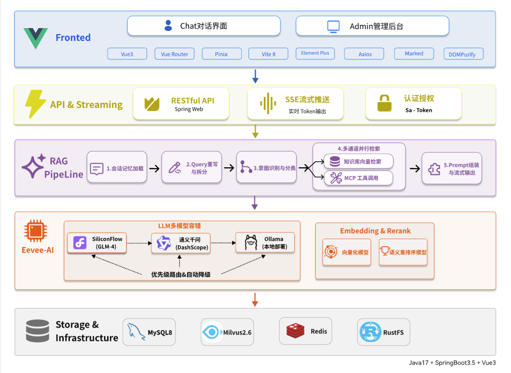


> 觉得不错？先点个 Star 收藏 


## 项目核心设计

采用前后端分离的架构模式，后端按职责分为四个 Maven 模块。

这里需要重点说下，分层不是为了炫技，而是解决实际问题：`core-framework` 层提供与业务无关的通用能力，`eevee-ai` 层屏蔽不同模型供应商的差异，`main-application` 层专注业务逻辑。换模型供应商不用改业务代码，换业务逻辑不用动基础设施。


## 控制台展示

EeveeAgent 提供完整的可视化控制台，覆盖**普通用户与管理员用户**两类使用场景，界面简洁直观，操作高效便捷。

系统通过多轮 AI 辅助设计优化，在保证功能完整性的同时，提供更加现代化和友好的交互体验。


### 1.用户问答界面

用户访问 EeveeAgent 首页后，可在输入框中直接输入问题发起问答，同时支持开启**深度思考模式**以获得更高质量的回答。

输入框上方提供示例问题标签，用户点击即可自动填充问题，方便快速体验系统能力。

- 支持自然语言输入
- 支持示例问题快速填充
- 支持深度思考模式

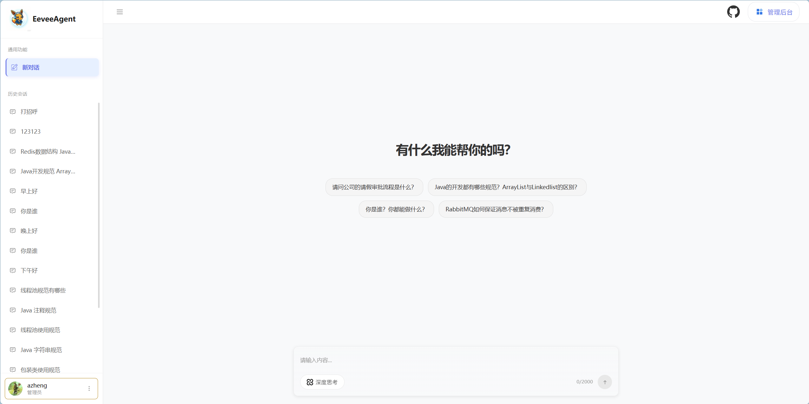

用户提交问题后，模型会实时生成回答结果，并提供良好的阅读体验：

- 支持 Markdown 格式渲染
- 支持图片内容展示
- 支持代码高亮显示
- 支持回答评价（点赞 / 点踩）

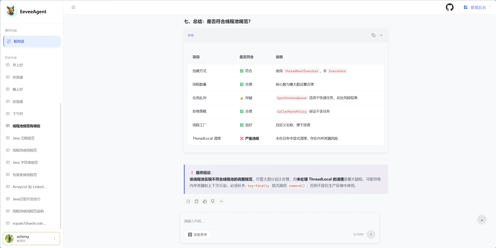


### 2.管理后台

EeveeAgent 提供功能完善的管理后台，用于系统配置与运行管理。管理员可以通过后台完成模型管理、系统配置及数据管理等操作。


<details>   <summary>**管理后台截图**（点击展开）</summary>    
    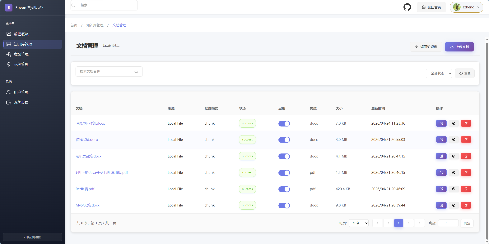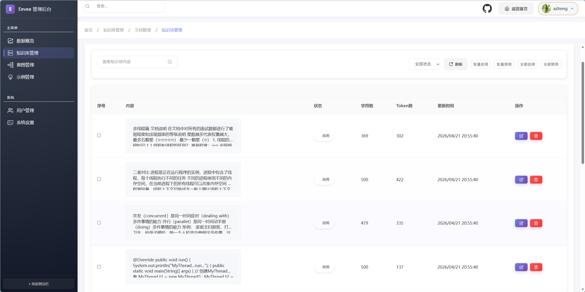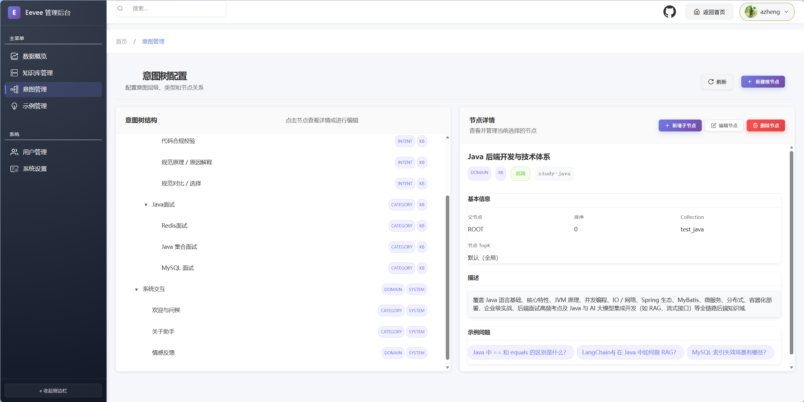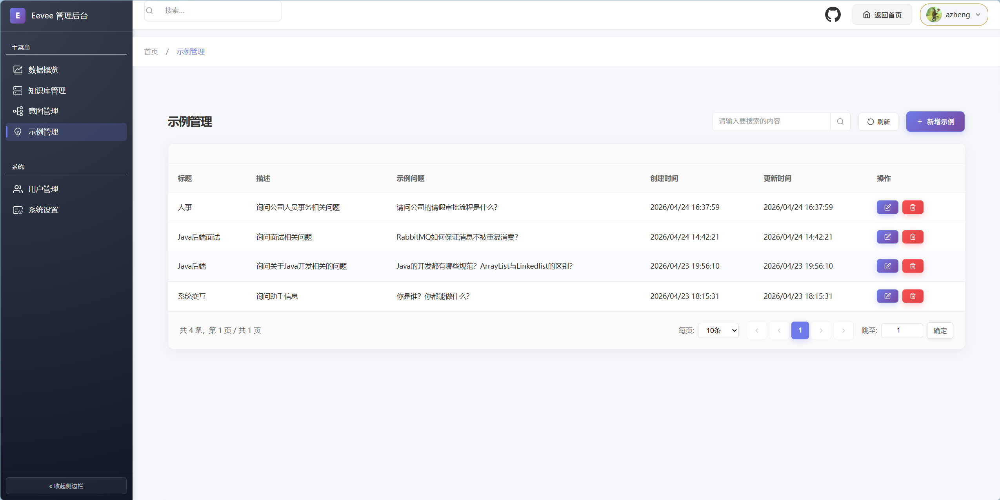
    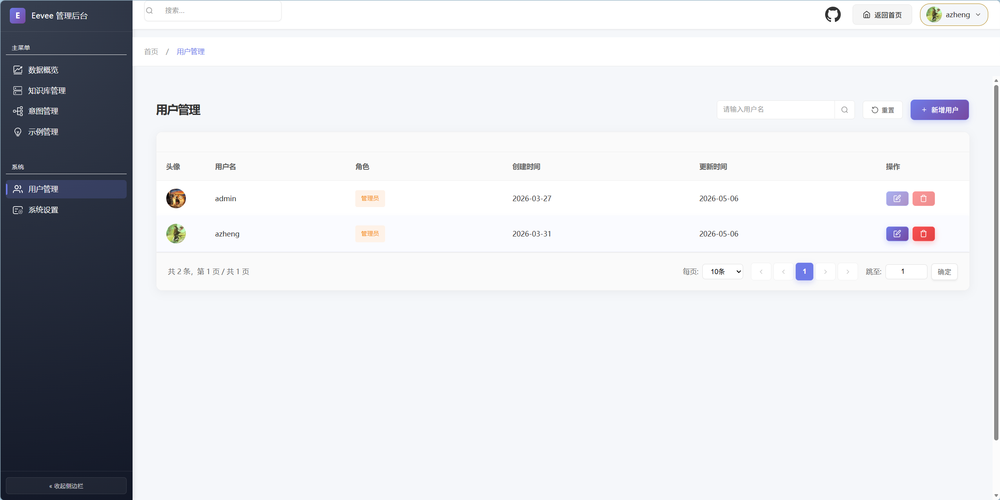
</details>

为了避免传统系统常见的毛坯界面体验，EeveeAgent 的控制台经过多轮 AI 辅助设计与优化，逐步迭代完善，最终呈现出当前简洁、美观且实用的界面效果。


# 启动EeveeAgent


## 环境准备

### 1. IDE 安装

项目需要 IntelliJ IDEA 2023 及以上版本。

如果没有专业版，可以使用社区免费版。社区版在部分功能和插件支持上有所限制，但不影响项目的正常开发。

IDEA 下载地址：https://www.jetbrains.com/zh-cn/idea

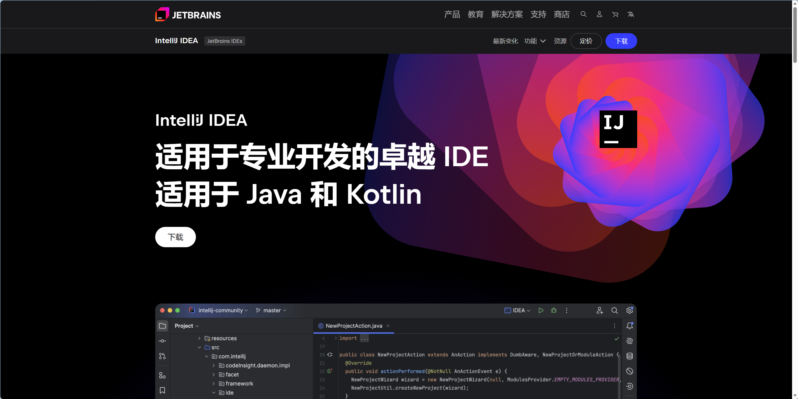

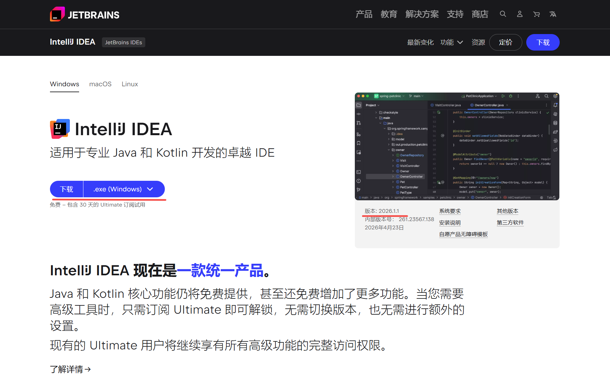

### 2. JDK 安装

Ragent 系统框架基于 SpringBoot3 开发，要求 JDK 版本不低于 17。请根据操作系统下载对应的 JDK17 版本。

- [Azul Zulu Windows](https://www.azul.com/downloads/?version=java-17-lts&os=windows&package=jdk#zulu)
- [Azul Zulu MacOS](https://www.azul.com/downloads/?version=java-17-lts&os=macos&package=jdk#zulu)

以 Windows 为例，大部分电脑为 x86 架构，选择第一个下载即可。

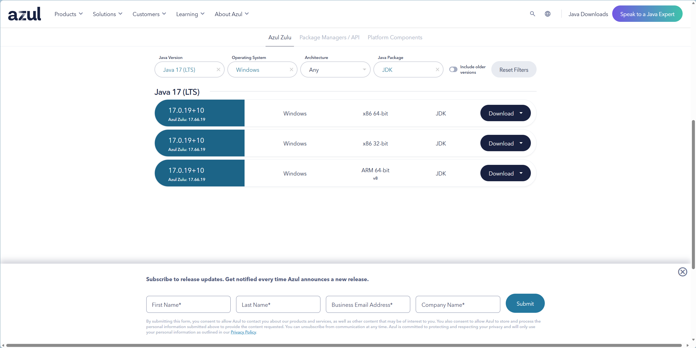


## 项目克隆与配置

### 1. 克隆项目

打开 GitHub 项目地址：https://github.com/Comebr/EeveeAgent  复制 SSH 克隆地址。

> 如果访问 GitHub 较慢，可使用 Gitee 镜像地址：https://gitee.com/running-ayang/my-agent

建议使用 Git 克隆而非下载 ZIP 压缩包。通过 Git 克隆的项目可以方便地拉取远程仓库的最新代码，EeveeAgent后续会持续更新迭代。（优先拉取Github仓库，Gitee 可能更新不及时）


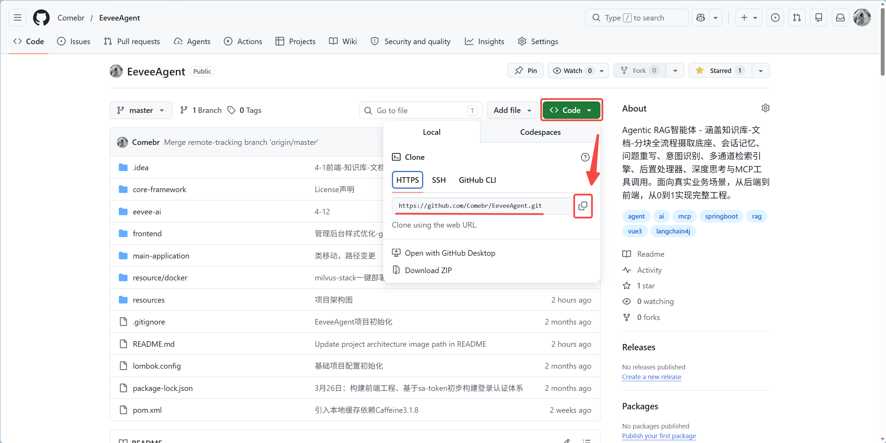


打开 IntelliJ IDEA，在菜单栏找到 Git -> Clone 选项（不同操作系统位置可能略有差异）。

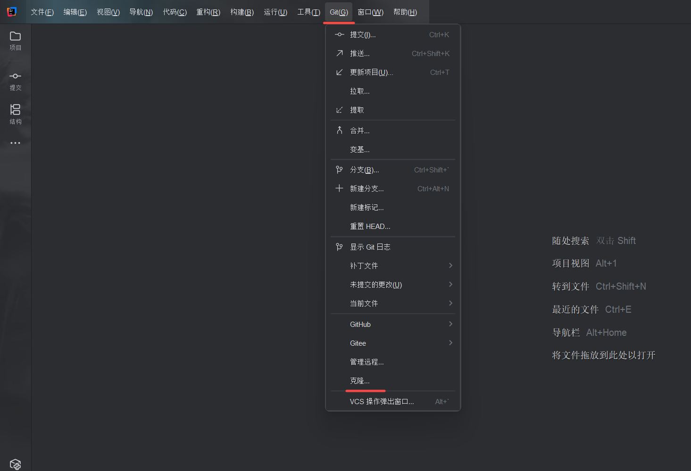


在 URL 文本框中填写SSH 地址，Directory 填写项目在本地的存储路径。

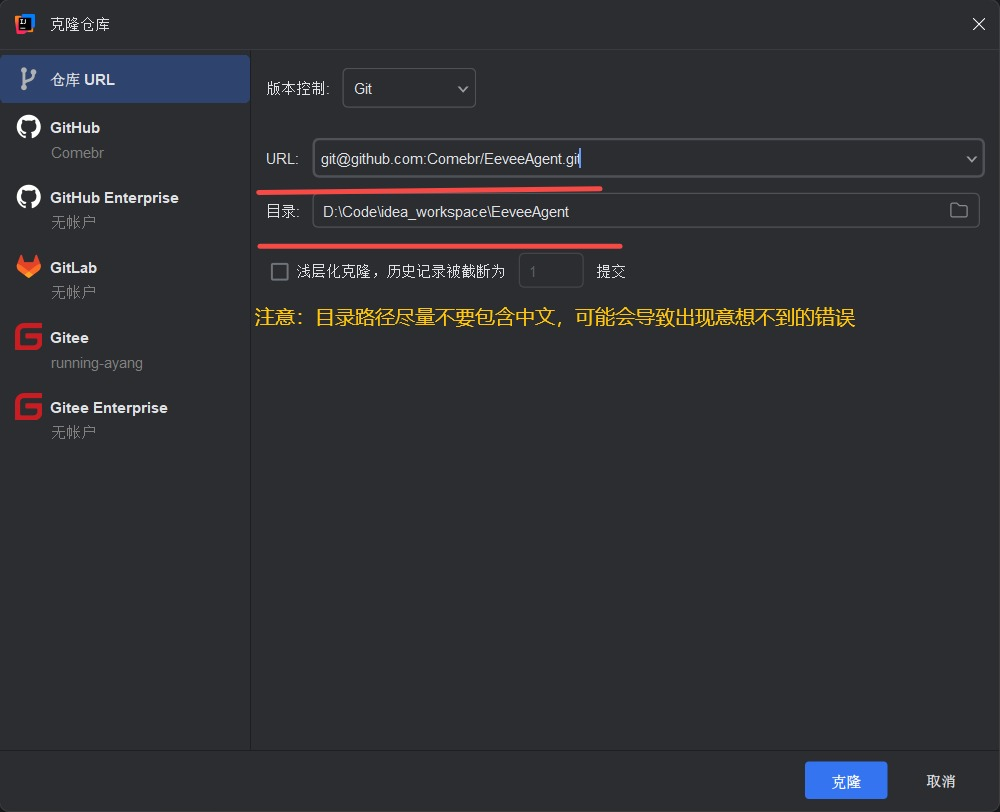


### 2. 配置 Maven 环境

可以先使用 IDEA 默认的 Maven 编译项目，如果编译成功则无需额外配置。如果编译失败，请尝试更换 Maven 版本。

> Maven 版本过低或过高（3.9.3 及以上）可能导致与 IDEA 的兼容性问题，引发项目编译错误。

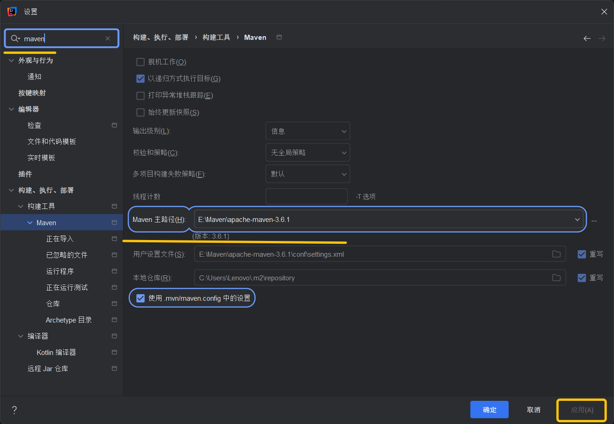

### 3. 配置 JDK17

项目克隆成功后，在 IDEA 中打开 `Project Structure...` 配置，检查 JDK 版本。

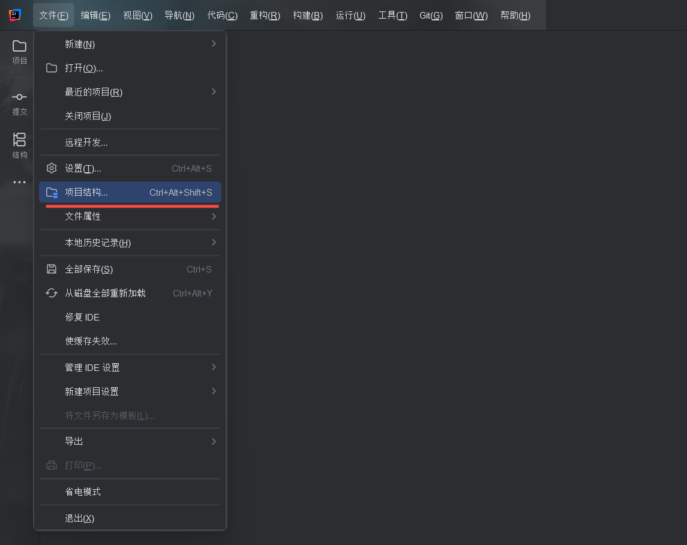


确认 JDK 版本为 17，否则会导致项目编译失败或 Maven 打包异常。Oracle、OpenJDK都可以

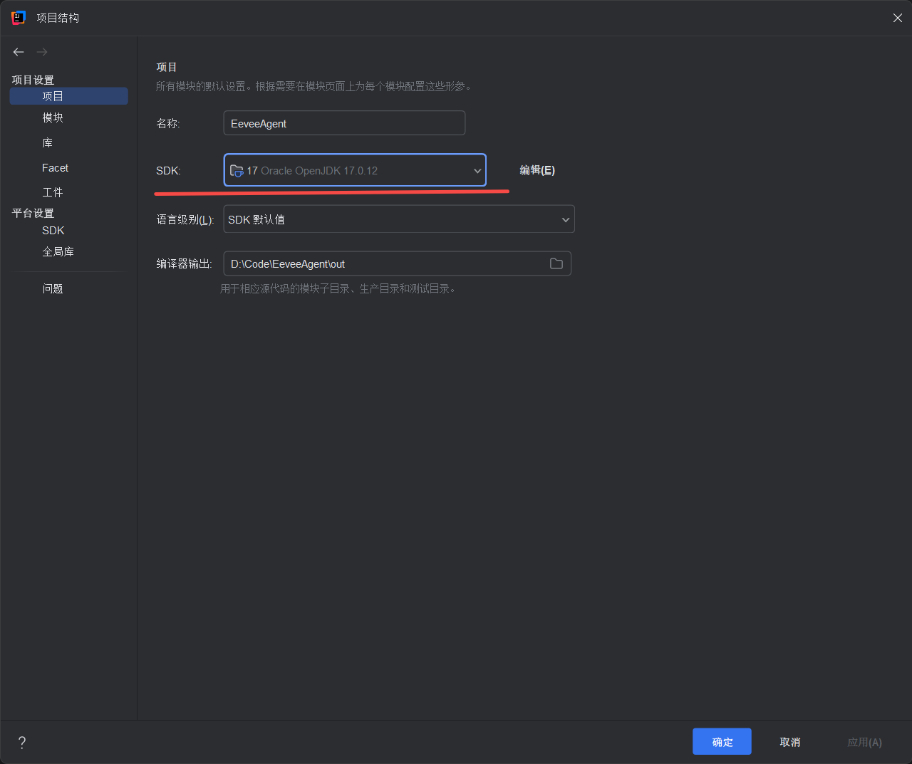


配置完成后，点击项目右侧的 Maven 图标进行编译测试。如果 Maven 打包成功，说明环境配置正确，可以开始项目开发。

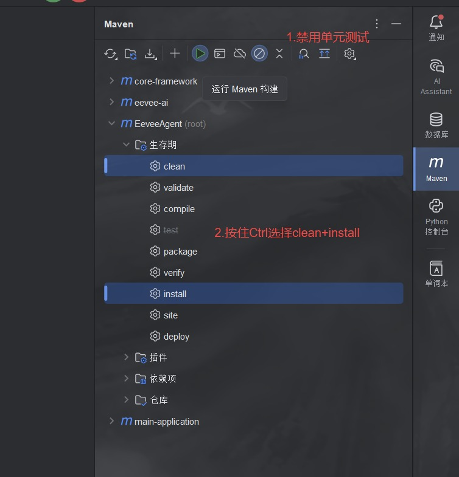


## 项目更新

项目后续可能会持续迭代和修复问题，建议在每次开始开发前，先拉取最新代码


------

至此，项目的克隆和基础配置已完成。如果在配置过程中遇到问题，可以检查 JDK 和 Maven 版本是否符合要求，或参考项目的 README 文档获取更多帮助。


# Docker中间件部署

EeveeAgent AI 项目使用 Docker 安装中间件，如果电脑尚未安装 Docker 相关软件，请先完成安装。

### 1.MySQL

```bash
docker run -d \
  --name eevee-mysql \
  -p 3306:3306 \
  -e MYSQL_ROOT_PASSWORD=123456 \
  -e MYSQL_DATABASE=eeveeagent \
  -e MYSQL_USER=admin \
  -e MYSQL_PASSWORD=123456 \
  -e TZ=Asia/Shanghai \
  -v mysql-data:/var/lib/mysql \
  mysql:8.0 \
  --character-set-server=utf8mb4 \
  --collation-server=utf8mb4_unicode_ci
```


### 2.Redis安装

```bash
docker run -d \
  --name eevee-redis \
  -p 6379:6379 \
  -e REDIS_PASSWORD=123456 \
  -v redis-data:/data \
  redis:7.2-alpine \
  redis-server --requirepass 123456 --appendonly yes
```


### 3.Milvus 向量数据库栈

如果未安装Docker Compose请先自行安装，这里一虚拟机部署为例

#### 3.1 创建工作目录

```bash
mkdir -p ~/milvus && cd ~/milvus
```
#### 3.2 下载 Milvus 配置文件

```bash
curl -O https://raw.githubusercontent.com/milvus-io/milvus/
v2.6.6/deployments/docker/standalone/docker-compose.yml
```
或者使用项目自带的配置文件（如果已经上传到服务器）：

```bash
# 如果你的项目文件已经在服务器上，直接进入对应目录
cd /path/to/EeveeAgent/resource/docker
```


#### 3.3 启动 Milvus

```bash
# 如果使用下载的配置
docker-compose up -d

# 如果使用项目自带的配置
docker-compose -f milvus-stack-2.6.6.compose.yaml up -d
```
#### 3.4 查看启动状态

```bash
docker-compose ps
```
等待几分钟后，看到所有服务状态都是 "Up" 就说明启动成功了。


## 客户端工具

### 1. Redis Desktop

Redis 客户端连接工具使用 [AnotherRedisDesktopManager](https://github.com/qishibo/AnotherRedisDesktopManager/releases)，大家点击链接可跳转 GitHub 下载最新版本。

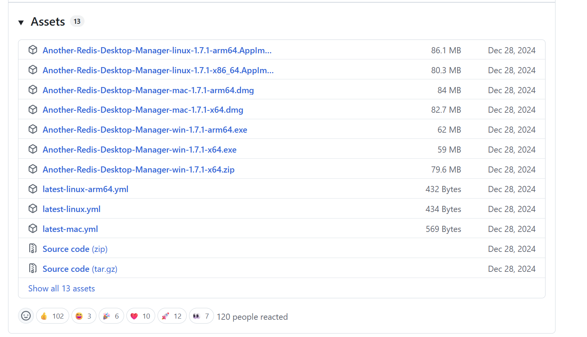

### 2.Attu 管理界面

进入之后就是Milvus数据库的可视化界面了


### 3. RustFS

RustFS 提供了 Web 控制台，用于管理对象存储、创建存储桶（Bucket）、上传下载文件以及配置访问策略。登录控制台后，可在 **Buckets** 页面创建存储桶，设置访问权限和生命周期策略，并直接进行文件的上传、下载和管理操作。

**登录信息**

| 项目                   | 值                                                |
| :--------------------- | :------------------------------------------------ |
| 控制台地址             | [http://你的IP地址:9001](http://你的IP地址:9001/) |
| API 地址（代码中使用） | [http://你的IP地址:9000](http://你的IP地址:9000/) |
| 账号                   | rustfsadmin                                       |
| 密钥                   | rustfsadmin                                       |

打开控制台地址后，输入账号和密钥，点击 **登录** 按钮即可登录。


## IDEA 整合 Docker

此外若是使用IDEA开发，可以通过服务一键启动所有中间件

### 1.前置准备

开启 Docker 远程 API（关键！IDEA 连接必备）

Docker 默认不开放外部连接，需开启 **2375 端口远程访问**：


**Windows/Mac Docker Desktop**

1. 打开 Docker Desktop → Settings → Resources → Advanced
2. 勾选 **Expose daemon on tcp://[localhost:2375](https://localhost:2375) without TLS**
3. 点击 Apply & Restart 重启 Docker


**Linux 配置**

编辑 Docker 配置文件：

```bash
vim /usr/lib/systemd/system/docker.service
```

修改 `ExecStart` 后面追加：

```bash
-H tcp://0.0.0.0:2375 -H unix:///var/run/docker.sock
```

重启 Docker：

```bash
systemctl daemon-reload
systemctl restart docker
```


### 2.IDEA 配置 Docker 连接

1. 打开 IDEA → `File` → `Settings`（快捷键 `Ctrl+Alt+S`）

2. 找到 `Build, Execution, Deployment` → `Docker`

3. 点击右上角 **+** 新建 Docker 配置

4. 选择 

   TCP socket，地址填写：

   ```
   tcp://你的IP地址:2375
   ```

5. 点击 **Test connection**，显示 **Connection successful** 即为连接成功

6. 点击 Apply → OK 保存

> 新版 IDEA 自带 Docker 插件，无需额外安装；若没看到，去插件市场搜索 `Docker` 启用。


### 3.IDEA 自带 Docker 面板常用操作

底部菜单栏打开 **Docker** 面板，功能全覆盖：

- **Images**：查看本地所有镜像、删除镜像、重新构建
- **Containers**：启停容器、删除容器、查看日志、进入终端
- **Logs**：实时打印项目控制台日志，和本地运行一致
- 支持直接在 IDEA 内执行：重启、停止、删除、拉取镜像等操作，不用敲任何命令


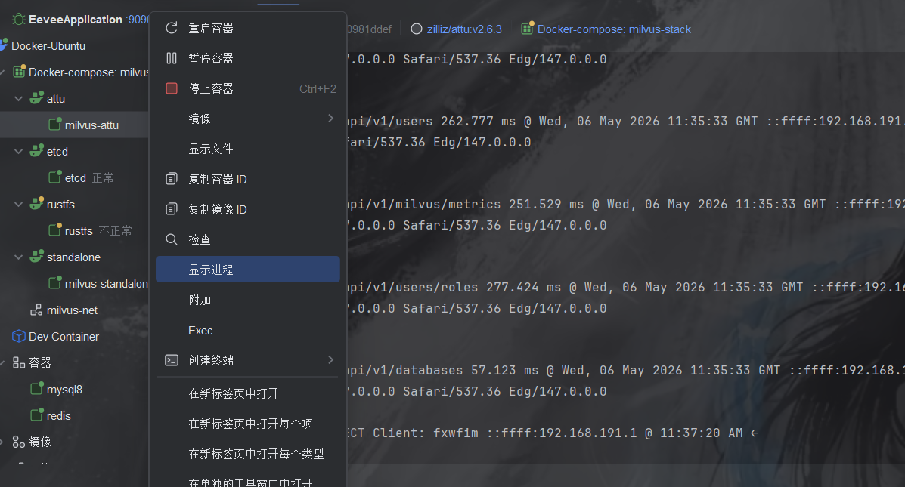


------

至此，本地中间件环境及客户端工具已完成安装与基本配置。

大家可以通过各自的 Web 控制台和客户端工具验证服务是否正常运行，并进行初步操作。


# MySQL数据库初始化

## SQL 脚本文件说明

在项目的 `/resources/database` 目录下，包含以下两个核心 SQL 脚本文件：

**文件说明：**

| 文件名        | 功能描述                                   | 执行顺序 |
| :------------ | :----------------------------------------- | :------- |
| schema.sql    | 包含数据库创建语句、表结构定义、索引配置   | 1        |
| init_data.sql | 包含业务初始化数据，如系统配置、角色权限等 | 2        |

⚠️ **重要提示：** 必须按照上述顺序依次执行 SQL 脚本，否则可能因表不存在而导致数据插入失败。


## 图形化客户端工具（推荐）

图形化工具提供了更直观的操作界面，适合不熟悉命令行的开发者。以下以 **Navicat** 为例进行演示，其他工具（如 TablePlus、pgAdmin）的操作流程类似。

> 由于我平时习惯使用 **Navicat**，因此本次演示将基于该工具进行操作。


步骤1：打开 Navicat，连接到MySQL数据库

左侧点击**连接** → **MySQL**

填写连接信息：

- 连接名：自定义（如本地 MySQL）
- 主机：`localhost` 或 `127.0.0.1`
- 端口：默认 `3306`
- 用户名：`root`
- 密码：123456

点击**测试连接**，提示连接成功后，点击**确定**

双击左侧新建的连接，进入数据库列表

**步骤 2：导入建表脚本**

选择 **运行 SQL 文件**—>弹出窗口，点击**浏览**，找到 schema_pg.sql 初始化文件—>编码默认 `UTF-8` 不用改—>点击**开始**—>下方进度条跑完，提示**执行成功**即可


**步骤 3：导入初始化数据**

重复上述步骤，导入 `init_data_pg.sql` 文件。执行成功后，可打开 `user` 表查看是否有初始数据。


## 贡献指南

欢迎贡献代码和提出建议！

1. **Fork** 项目仓库
2. **创建** 功能分支
3. **提交** 代码修改
4. **推送** 到远程分支
5. **创建** Pull Request

## 许可证

本项目采用MIT许可证，详见LICENSE文件。

---

**EeveeAgent** - 智能Agent系统
