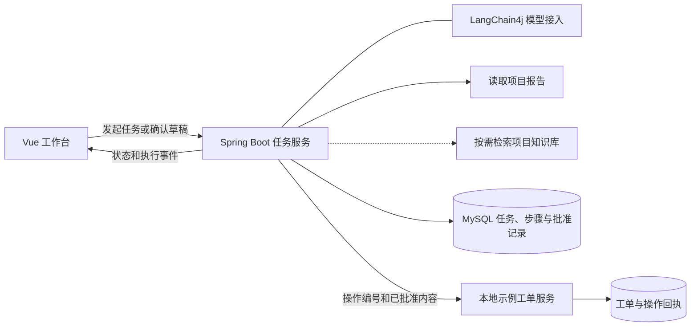

# Eevee-Agent 自托管 Java Agent 工作台首版方案

**范围已于 2026-11-20 确认。** 本文是后续迭代与验收的基准。工程现状以 `e2e6798` 的工作区为起点，M1 至 M4 的完成情况以实际运行和测试结果为准。

## 产品定位与首版边界

在现有 Eevee-Agent 仓库上交付一个可自托管的 Web 工作台。用户委托任务后，能看到助手依据哪些资料作出判断、自己批准了哪一次写操作，以及中断后该操作的实际结果。开源交付面向 Java 后端与 AI 应用开发者，简历展示侧重能复现的设计取舍、失败案例和实测结果。

首个公开场景是 **Maven 测试故障协查**。工作台读取既有报告，按需查项目手册，生成有出处的诊断。用户要求开单时，助手生成草稿，由任务发起人确认后写入独立的本地示例工单服务。工单服务真实提交数据，并提供按操作编号查询结果的能力。

首版沿用 Vue、Spring Boot、LangChain4j 和 MySQL。独立 Java SDK、线上 GitHub/Jira 适配和多人审批列为后续可选方向。

## 一次任务怎样完成

1. **选择项目并读取报告。** 用户在浏览器中选择服务端已登记、该用户可访问的工作区。工作台读取已有的 Surefire XML，定位失败的测试类、方法、异常和对应报告。公开样例将报告随仓库保存，另附生成方式，避免依赖某台机器的构建产物。[Maven Surefire 报告说明](https://maven.apache.org/surefire/maven-surefire-plugin/)
2. **诊断并展示证据。** 报告事实指向对应测试用例或异常。解释依赖项目约定时，助手在该项目允许的知识库中查找手册，引用原文档和片段。报告只证明请求超时时，诊断列出已知事实和确认根因所缺的信息。关闭知识库时，基础报告分析仍可完成。
3. **审阅工单草稿。** 仅请求分析的任务在展示诊断后结束。用户要求建单时，工作台展示目标项目、标题、正文和证据引用。仅任务发起人能确认当前草稿版本。修改草稿会生成新版本，旧版本的确认失效。拒绝草稿会终止此次写操作。
4. **取得回执或核实结果。** 工作台持久化已批准的操作，再调用本地工单服务。成功时展示工单号。响应丢失或服务重启时，按原操作编号核实结果。用户刷新页面只会重新读取任务进度。

## 技术分工与复用

| 部分 | 现有基础 | 首版改造 |
| --- | --- | --- |
| 工作台与身份 | Vue 聊天页、登录用户、会话历史和 SSE 文本输出。[聊天页](../../frontend/src/components/Home.vue) | 增加任务时间线、证据引用、草稿确认和回执视图。刷新后按任务编号加载状态，写操作由后端核验发起人和草稿版本。 |
| 模型与工具 | 已有模型路由和固定天气 MCP 调用样例。[模型路由](../../eevee-ai/src/main/java/com/azheng/agent/model/AiModelRouterImpl.java) · [天气工具](../../mcp-server/src/main/java/com/azheng/mcp/executor/WeatherMcpExecutor.java) | 在任务服务中复用模型接入，处理工具请求并向模型回传结果。Java 执行层负责工作区范围、参数与审批校验。[LangChain4j 工具调用](https://docs.langchain4j.dev/tutorials/tools/) |
| 报告与知识 | 普通知识问答已有检索、重排和流式回答。[问答入口](../../main-application/src/main/java/com/azheng/boot/rag/service/Impl/RAGChatServiceImpl.java) | 报告作为只读工具，RAG 作为可选工具。检索显式限定允许的知识库，重排保留原文档和片段标识。当前全局检索只按删除标记筛集合，重排会用候选序号填入结果 ID。[全局检索](../../main-application/src/main/java/com/azheng/boot/rag/core/retrieval/chanel/strategy/VectorGlobalSearchChannel.java) · [重排实现](../../main-application/src/main/java/com/azheng/boot/rag/core/rerank/DashScopeRerankService.java) |
| 持久化与写操作 | 已有会话和消息表，流式回答的取消句柄在进程内。[现有表结构](../database/schema.sql) · [句柄缓存](../../main-application/src/main/java/com/azheng/boot/rag/config/CaffeineConfig.java) | MySQL 保存任务、工具步骤、草稿版本、批准记录、操作编号和结果。工单服务在自己的事务中保存工单和回执，工作台据此核对写入结果。 |

基础模式的验收条件是关闭知识库也能启动并分析报告。实现时需处理 Milvus 客户端和意图缓存的启动期初始化。安装说明应列清基础模式所需的模型服务、数据库及登录或缓存依赖。[Milvus 初始化](../../main-application/src/main/java/com/azheng/boot/rag/core/embedding/milvus/config/MilvusClientConfig.java) · [意图初始化](../../main-application/src/main/java/com/azheng/boot/rag/core/intent/DefaultIntentClassifier.java)

## 写操作的确认与恢复

一次会话可以产生多次任务。每次任务跟踪自己的执行步骤，每个获准写入的动作有一个稳定的操作编号。任务服务在发出请求前保存操作编号、目标、发起人和已批准的草稿版本。重试和恢复沿用同一编号与同一份批准内容。

| 情况 | 系统行为 | 验收依据 |
| --- | --- | --- |
| 用户拒绝、其他用户尝试确认、或提交旧版本的确认 | 拒绝写入。草稿修改后须由发起人确认新版本。 | 检查工作台状态与工单库，目标项目的工单数未增加。 |
| 等待确认时工作台服务重启 | 恢复原任务和同一版草稿，继续等待确认。 | 浏览器重连后能看到原证据和草稿，工单服务尚未收到写请求。 |
| 用户重复或并发确认 | 任务服务只接受一次有效确认。工单服务按操作编号防重，同编号、同内容返回原工单，同编号、不同内容报告冲突。 | 多次请求对应同一个工单号；按原编号查询只有一条业务记录。 |
| 工单已提交，响应丢失或工作台在记录成功前退出 | 恢复后先按原编号查询回执，查到即补记成功。暂时查不清则标记“待核实”。需要重试时按同号幂等契约办理。 | 注入“提交后丢响应”故障，分别核对任务状态、操作编号、回执和工单记录数。 |

这里的防重结论依赖本地工单服务支持同号幂等写入和结果查询。后续接入其他平台时，应按该平台提供的契约重新确定恢复策略。

## 里程碑与交付证据

| 阶段 | 完成条件 | 可交付证据 |
| --- | --- | --- |
| **M1　可启动的基线** | 从干净环境按说明打开工作台，关闭知识库也能读取随仓库提供的已知失败报告。样例给出预期失败位置。 | 启动说明、公开样例项目、已生成的报告和复现说明。 |
| **M2　有证据的诊断** | 覆盖正常测试、明确失败、证据不足三类输入。需要手册时能引用正确片段，只请求分析时没有工单写入。 | 含预期工具选择、证据位置和允许结论的标注样例，以及实际输出与失败案例。 |
| **M3　可恢复的写操作** | 跑通草稿、确认、真实落库和回执查询，逐项通过上表的拒绝、过期确认、并发确认、重启及丢响应场景。 | 固定故障用例、工作台任务记录、工单服务回执及实际记录数。这一阶段形成核心面试演示。 |
| **M4　公开评测与简历材料** | 公布样例与预期行为，分别记录离线确定性回归和真实模型调用结果。简历只引用实际测得的结果。 | 模型与配置说明、评测表、可复现的失败案例，以及一次端到端演示。 |

M1 至 M3 是首版开发承诺，M4 是简历交付标准。模型评测记录每类任务的样本数、工具选择正确数、引用正确数和证据不足时的表现。执行评测逐例记录预期状态、实际状态、工单数和仍待核实的结果，区分界面反馈与工单服务实际产生的业务记录。
