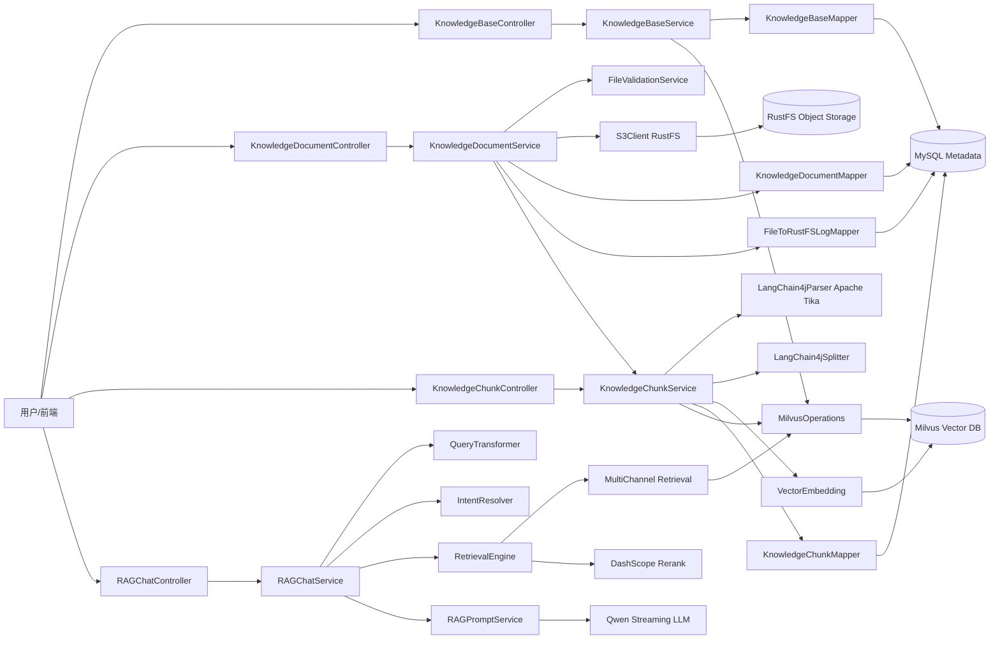
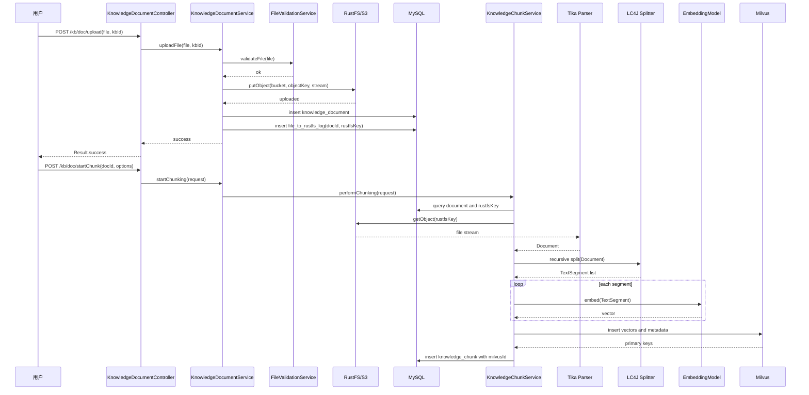
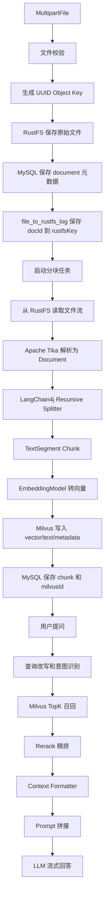
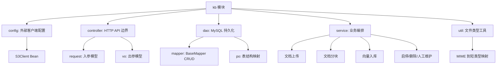
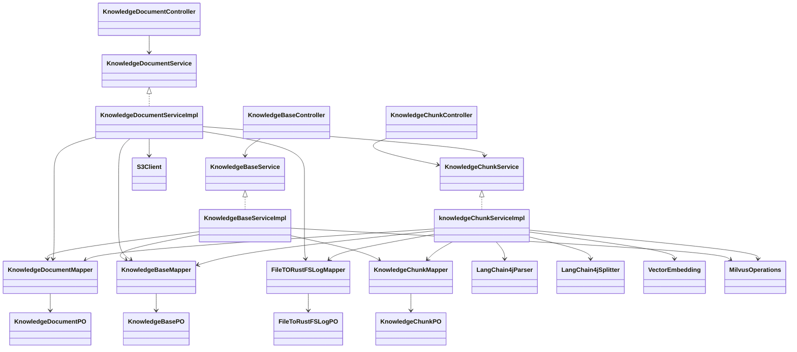

# kb 模块企业级架构分析文档

## 文档定位

本文基于 `main-application/src/main/java/com/azheng/boot/kb` 与相关 `rag/core` 真实代码实现，分析当前项目中的知识库模块。它不是逐行代码翻译，而是从企业级 AI 知识库系统、Java 后端工程化、RAG 基础设施、对象存储、向量检索和分块索引链路的角度，说明该模块在整个系统中的设计价值、核心流程、风险点和优化方向。

主要代码依据：

- `kb/config/RustFSClientConfig.java`：RustFS S3 兼容客户端配置。
- `kb/controller/*`：知识库、文档、知识块管理 API。
- `kb/dao/po/*` 与 `kb/dao/mapper/*`：MySQL 元数据模型与 MyBatis-Plus 持久化。
- `kb/service/Impl/*`：知识库创建、文档上传、分块、向量化、管理操作。
- `rag/core/parser/LangChain4jParser.java`：从 RustFS 读取对象并使用 Apache Tika 解析文档。
- `rag/core/chunking/*`：LangChain4j 文档分块。
- `rag/core/embedding/milvus/*`：Embedding 与 Milvus collection、insert、search、upsert。
- `rag/core/retrieval/*`：多通道召回、rerank、上下文拼接。
- `rag/core/prompt/RAGPromptService.java` 与 `rag/service/Impl/RAGChatServiceImpl.java`：RAG Prompt 组装和 LLM 流式回答。

## 一、整体系统架构分析

### kb 模块职责

`kb` 模块是整个 AI/RAG 系统的知识资产管理中心。它负责把用户上传的非结构化文件转化为可管理、可索引、可召回的知识资产。当前代码中，`kb` 模块覆盖了三层核心资源：

- `KnowledgeBase`：知识库，是业务知识域的容器，记录知识库名称、Embedding 模型标识和 Milvus collection 名称。
- `KnowledgeDocument`：文档，是用户上传文件在系统中的元数据记录，记录所属知识库、文件名、文件类型、文件大小、启用状态等。
- `KnowledgeChunk`：知识块，是文档被解析、清洗、分块后的最小召回单元，记录文本片段、chunk 序号、字符数、估算 token 数以及 Milvus 主键。

从 RAG 系统角度看，`kb` 模块不是简单 CRUD。它承担的是“知识入库”与“知识可召回化”的职责：文件进入系统后，必须经过对象存储、元数据建模、文本解析、Chunking、Embedding、向量入库等步骤，最终才能被检索增强生成链路使用。

### KnowledgeBase、Document、Chunk 的关系

当前数据模型体现了典型的 RAG 知识层级：

- 一个 `KnowledgeBasePO` 对应一个业务知识库，并绑定一个 Milvus `collection`。
- 一个 `KnowledgeBasePO` 下可以有多个 `KnowledgeDocumentPO`。
- 一个 `KnowledgeDocumentPO` 上传到 RustFS 后，通过 `FileToRustFSLogPO` 保存 `docId -> rustfsKey` 映射。
- 一个 `KnowledgeDocumentPO` 被解析后产生多个 `KnowledgeChunkPO`。
- 一个 `KnowledgeChunkPO` 对应 Milvus 中的一条向量记录，二者通过 `milvusId` 关联。

这是一种“元数据在 MySQL，原始文件在对象存储，向量数据在 Milvus”的三存储架构。它避免了把所有东西塞进同一个数据库，也让文件管理、知识管理和向量检索可以独立扩展。

### 为什么知识库系统是 RAG 核心基础设施

RAG 的质量上限很大程度上由知识库系统决定。大模型本身负责语言理解和生成，但它不能天然知道企业内部文档、制度、产品知识和业务流程。知识库系统负责把这些业务知识转成大模型可用的上下文。

RAG 中的“检索增强”不是简单搜索，而是一个复杂工程链路：

- 文档是否能被正确解析，决定知识是否完整进入系统。
- Chunk 切分是否合理，决定召回粒度和上下文噪声。
- Embedding 模型和向量维度是否一致，决定语义检索质量。
- Milvus collection、索引、TopK、rerank 是否合理，决定召回效果。
- Prompt 拼接是否干净，决定 LLM 是否能基于知识作答。

因此，`kb` 模块是 RAG 的数据底座。没有稳定的知识入库和索引链路，后面的检索、rerank、prompt 和 LLM 都会变成“无源之水”。

### 系统完整链路

#### 用户上传文件

前端通过 `POST /kb/doc/upload` 上传 `MultipartFile` 和 `kbId`。Controller 只接收请求并委托 `KnowledgeDocumentService.uploadFile`，这符合 Controller 不写业务逻辑的分层原则。

#### 文件校验

`FileValidationService.validateFile` 对上传文件进行准入校验，包括空文件、大小、MIME 类型、扩展名、基本可读性和加密文件判断。当前最大文件限制为 50MB，支持 pdf、doc、docx、xls、xlsx、txt、md。

这一步的架构意义是把不安全、不可解析、成本过高的文件挡在索引链路之前，避免后续 Tika 解析、Embedding 调用、Milvus 写入浪费资源或引发安全问题。

#### RustFS 对象存储

`KnowledgeDocumentServiceImpl.uploadFile` 使用 Spring 注入的 `S3Client` 将文件流写入 RustFS。Object Key 采用 `uploadFile/{uuid}/{filename}` 结构，避免同名文件覆盖。

对象存储适合保存原始文件，因为文件是大对象、非结构化、读写模式和数据库元数据不同。MySQL 更适合存储文件属性、状态、索引关系和业务元数据，不适合长期承载大量二进制文件。

#### MySQL 元数据存储

文件上传成功后，系统向 `knowledge_document` 插入文档元数据，再向 `file_to_rustfs_log` 插入 `docId -> rustfsKey` 映射。这样 MySQL 只保存“文件在哪里、属于哪个知识库、当前是否启用、是否删除”等结构化信息。

#### Chunk 分块

`/kb/doc/startChunk` 会触发 `KnowledgeDocumentService.startChunking`，最终调用 `knowledgeChunkServiceImpl.performChunking`。服务先根据 `docId` 找到 RustFS Key，再从对象存储读取文件并使用 Apache Tika 解析为 LangChain4j `Document`，随后用 `DocumentSplitters.recursive(maxChunkSize, maxOverlapSize)` 切成 `TextSegment`。

当前默认分块配置是 `maxChunkSize=512`、`maxOverlapSize=0`。这意味着系统倾向于较细粒度召回，但没有重叠窗口，跨段语义可能会断裂。

#### Embedding 向量化

`VectorEmbedding.embed` 遍历 `TextSegment`，调用注入的 `EmbeddingModel` 转成向量，并构造 Milvus JSON 数据。字段包括：

- `chunk_text_vector`：文本向量。
- `chunk_text_varchar`：原始 chunk 文本。
- `metadata`：TextSegment 元数据，例如 docId、file_name、index。

`LLMConfig` 当前使用 DashScope 兼容 OpenAI 接口的 `text-embedding-v4`，配置维度为 2048。

#### Milvus 向量库存储

创建知识库时，`KnowledgeBaseServiceImpl.create` 会调用 `MilvusOperations.createChunkCollection` 创建对应 collection。Milvus schema 包括自增主键 `chunk_id`、向量字段、文本字段和 JSON 元数据字段，并对向量字段建立 `AUTOINDEX + COSINE` 索引。

分块向量化后，`VectorEmbedding.embed` 将数据插入指定 collection，并返回 Milvus 主键。系统再把 `milvusId` 写入 `knowledge_chunk`，实现 MySQL chunk 元数据和 Milvus 向量实体的关联。

#### 检索召回

用户发起 RAG 对话后，`RAGChatServiceImpl.streamingChat` 先进行查询改写、意图识别，再调用 `RetrievalEngine.retrieval`。检索层通过 `MultiChannelRetrievalEngine` 并行执行不同检索通道：

- `IntentDirectedSearchChannel`：根据识别出的 KB 意图检索指定 collection。
- `VectorGlobalSearchChannel`：当意图不足或置信度低时，在所有知识库 collection 中做全局向量检索。

底层搜索由 `MilvusOperations.search` 完成：先把用户问题转成向量，再在 Milvus 中执行 TopK 语义检索，返回 chunk 文本、metadata 和相似度分数。

#### Prompt 拼接

召回结果经过 `RerankPostProcessor` 调用 DashScope rerank 模型重排，再由 `DefaultContextFormatter` 格式化为知识库上下文。`RAGPromptService.buildStructuredMessages` 会构造系统提示词、知识库证据和用户问题，形成最终 ChatMessage 列表。

#### LLM 生成回答

`RAGChatServiceImpl` 使用 `LLMConfig.buildQwenFlashStreamingModel` 创建流式聊天模型，将结构化消息发送给模型，通过 SSE 向前端流式输出。模型回答完成后，系统异步持久化对话、更新记忆并生成会话标题。

## 二、目录结构分析

### config

`RustFSClientConfig` 负责创建名为 `RustFSClient` 的 `S3Client` Bean。RustFS 兼容 S3 协议，因此使用 AWS SDK 的 `S3Client` 是合理选择。

企业项目中对象存储客户端需要统一配置，原因包括：

- 连接参数、凭证、region、path style 等应集中管理。
- 客户端生命周期由 Spring 容器维护，便于复用连接和统一销毁。
- 业务层只依赖抽象 Bean，不关心客户端构造细节。
- 后续切换 RustFS、MinIO、AWS S3 或云厂商对象存储时，改配置层即可。

企业项目不建议在业务代码里直接 `new S3Client`。直接 new 会导致配置散落、凭证泄漏、测试困难、连接复用差，也不利于统一观测和故障治理。

当前实现的不足是：`RustFSClientConfig` 中 endpoint 和账号密码写死，而 `application.yaml` 里又有 `rustfs.url`、`access-key-id`、`secret-access-key` 配置。企业级做法应改为 `@ConfigurationProperties(prefix = "rustfs")`，并从环境变量或密钥系统读取敏感信息。

### controller

Controller 层是 API 边界，职责是接收 HTTP 请求、做轻量参数绑定、调用 Service、统一返回 `Result`。它不应该写业务逻辑，因为业务逻辑需要事务、状态管理、外部资源编排和领域规则，放在 Controller 会导致复用困难、测试困难、接口层过重。

`request` 和 `vo` 分层体现了输入输出模型隔离：

- Request 表示前端传入参数，例如 `CreateKbRequest`、`StartChunkRequest`。
- VO 表示返回给前端的数据，例如 `KnowledgeBaseVO`、`KnowledgeDocumentVO`、`KnowledgeChunkVO`。
- PO 表示数据库持久化对象，不能直接暴露给前端。

当前 API 大体符合 REST 管理资源的思路，但命名仍偏 RPC 风格，例如 `/createKb`、`/deleteDoc/{id}`。更 RESTful 的形式可以是：

- `POST /kb`
- `DELETE /kb/{kbId}`
- `PATCH /kb/{kbId}/name`
- `POST /kb/doc`
- `POST /kb/doc/{docId}/chunks`

#### KnowledgeBaseController

该 Controller 暴露知识库维度 API：

- 创建知识库：`POST /kb/createKb`
- 删除知识库：`DELETE /kb/deleteKb/{kb-id}`
- 重命名知识库：`PUT /kb/renameKb/{kb-id}`
- 分页查询知识库：`GET /kb/pageQuery`

它在系统中负责管理知识域容器。创建知识库不仅写 MySQL，还会创建 Milvus collection，这使 KnowledgeBase 成为 RAG 索引空间的上层抽象。

#### KnowledgeDocumentController

该 Controller 暴露文档维度 API：

- 上传文件：`POST /kb/doc/upload`
- 分页查询文档：`GET /kb/doc/pageQuery`
- 删除文档：`DELETE /kb/doc/deleteDoc/{id}`
- 启停文档：`POST /kb/doc/switch`
- 启动分块：`POST /kb/doc/startChunk`

它是“文件资产进入 RAG 系统”的入口。上传负责对象存储和元数据登记，启动分块负责把静态文件推进到可检索的向量化状态。

#### KnowledgeChunkController

该 Controller 暴露知识块维度 API：

- 分页查询 Chunk：`GET /kb/doc/chunk/pageQuery`
- 修改 Chunk 文本：`PUT /kb/doc/chunk/mkdirText`
- 手动新增单条 Chunk：`PUT /kb/doc/chunk/singleChunk`
- 删除 Chunk：`DELETE /kb/doc/chunk/deleteChunk/{id}`

它体现了企业 RAG 系统中的“人工校正知识”能力。很多知识库系统不能只依赖自动解析，还需要运营人员人工修改、删除、新增知识片段，提升召回质量。

### dao

`dao/mapper` 使用 MyBatis-Plus `BaseMapper`，封装基础 CRUD、分页、条件查询能力。`dao/po` 是数据库表结构在 Java 中的持久化对象映射。

MyBatis-Plus 在本项目中的定位是轻量 ORM 和 SQL 构造工具：

- `BaseMapper` 提供通用 CRUD。
- `QueryWrapper`、`Wrappers.lambdaQuery/lambdaUpdate` 提供动态条件构造。
- `Page` 和 `IPage` 提供分页模型。
- `MetaObjectHandler` 提供创建时间、更新时间自动填充。

数据库实体不能直接返回前端，原因包括：

- PO 可能包含内部字段，如 `delFlag`、`updateBy`、存储 key、审计字段。
- PO 会暴露数据库结构，前后端耦合过重。
- 前端视图字段经常与数据库字段不一致。
- 安全上不应把内部状态、存储路径、审计信息无选择暴露。

当前 `KnowledgeBasePO`、`KnowledgeDocumentPO`、`KnowledgeChunkPO` 已经通过对应 VO 做输出转换，这是较好的工程实践。

### service

企业项目使用接口加实现类，核心价值是隔离调用方和业务实现。Controller 依赖接口，具体实现可以替换、代理、加事务、加缓存、加异步、加限流，也利于单元测试 mock。

Service 层是业务核心，因为它负责：

- 参数校验和领域规则。
- 事务边界。
- MySQL、RustFS、Milvus、Embedding 模型之间的编排。
- 业务状态维护，例如启用、删除、索引状态。
- 将底层异常转换为业务异常。

#### KnowledgeDocumentService

当前实现承担文档生命周期管理：

- `uploadFile`：校验文件、上传 RustFS、写入文档元数据、写入 RustFS 映射。
- `docPageQuery`：根据知识库、文档名、启用状态分页查询。
- `deleteFile`：逻辑删除文档和归属 chunk。
- `setEnabled`：修改文档启用状态。
- `startChunking`：委托 Chunk Service 执行分块索引。

这类 Service 是 RAG 入库链路的入口编排器，应重点保证事务一致性、对象存储补偿、幂等性和状态机。

#### KnowledgeChunkService

当前实现承担知识块索引和人工维护：

- `performChunking`：RustFS 读取、Tika 解析、LangChain4j 分块、Embedding、Milvus 写入、MySQL chunk 写入。
- `insertChunk`：手动新增 chunk 并向量化。
- `updateChunkText`：更新 MySQL 文本并 upsert Milvus 向量。
- `remove`：逻辑删除 MySQL chunk。
- `pageQuery`：按文档分页查询 chunk。

这类 Service 是 RAG 可召回化的核心，应重点保证 MySQL 与 Milvus 的一致性。

#### FileValidationService

当前类负责文件准入校验，虽然命名为 Service，但实际是静态工具类。它在上传链路中很重要，因为文件上传系统面临真实安全风险：

- 恶意文件伪装扩展名。
- 超大文件导致内存或磁盘打满。
- 压缩炸弹、复杂 Office 文档导致解析器耗尽 CPU。
- 加密文件无法解析，浪费索引资源。
- MIME 类型由客户端提供，不可信。

企业级优化应引入魔数校验、Apache Tika detect、杀毒扫描、解析沙箱、上传频控和异步任务状态。

### util

`FileTypeUtil` 维护 MIME 类型到短文件类型的映射，用于把 `application/pdf`、`application/vnd.openxmlformats-officedocument.wordprocessingml.document` 等长 MIME 转成 `pdf`、`docx` 等展示字段。

文件类型校验很重要，因为知识库系统会把文件送入解析器和模型链路。如果文件类型不受控，攻击者可能利用解析器漏洞、上传脚本文件、上传超大文件或伪装内容，造成系统安全和稳定性风险。

## 三、知识库系统核心流程分析

### 文件上传流程

当前文件上传流程如下：

1. 前端提交 `MultipartFile file` 和 `kbId`。
2. Controller 调用 `KnowledgeDocumentService.uploadFile`。
3. `FileValidationService.validateFile` 校验空文件、大小、MIME、扩展名、可读性和加密状态。
4. 查询 `knowledge_base`，确认目标知识库存在。
5. 使用 Hutool UUID 生成唯一目录。
6. 构造 RustFS object key：`uploadFile/{uuid}/{filename}`。
7. 使用 `S3Client.putObject` 上传文件流到 bucket `a-bucket`。
8. 将 MIME 转成短文件类型。
9. 插入 `knowledge_document` 元数据。
10. 插入 `file_to_rustfs_log`，保存 `docId -> rustfsKey`。

对象存储比数据库更适合文件系统，原因是：

- 文件是大对象，数据库 BLOB 会造成备份、迁移、索引、缓存压力。
- 对象存储天然支持海量对象、分片、生命周期、低成本存储。
- 数据库适合保存结构化元数据和查询索引。
- 文件下载、预览、生命周期管理可以和业务元数据解耦。
- 对象 key 可以作为稳定引用，MySQL 只保存映射关系。

### 文档查询流程

`docPageQuery` 使用 `Page` 构造分页对象，使用 `QueryWrapper` 动态拼接条件：

- 必须匹配 `kb_id`。
- 必须匹配 `del_flag = 0`。
- 如果传入 `enabled`，则追加启用状态过滤。
- 如果传入 `documentName`，则追加模糊查询。
- 按 `update_time` 倒序。
- 最后通过 `result.convert(this::toVO)` 转为 VO。

企业系统喜欢逻辑删除，原因包括：

- 避免误删导致数据不可恢复。
- 保留审计、追责、历史分析能力。
- 删除知识库时可以异步归档、延迟清理对象存储和向量库。
- 对多存储系统更友好，可以先业务不可见，再后台补偿清理。

但逻辑删除必须全链路生效。当前 MySQL 中 `delFlag=1` 后，Milvus 中向量仍可能存在，检索直接查 Milvus 时无法自动感知 MySQL 的 `del_flag`，这是需要重点优化的点。

### Chunk 分块流程

Chunk 是 RAG 中的最小检索和上下文拼接单元。一个文档通常太长，无法直接放入 Embedding 或 LLM 上下文窗口，因此必须切成多个语义片段。

RAG 必须 Chunk，原因包括：

- Embedding 模型有输入长度限制。
- LLM 上下文窗口有限，不能塞入整篇文档。
- 检索需要精确命中问题相关片段，而不是整篇文档。
- 过大的文本会降低向量表达精度。
- 过小的文本会丢失上下文。

Chunk 大小影响召回质量：

- 过大：召回噪声高，向量语义被稀释，Prompt 成本高。
- 过小：上下文缺失，答案不完整，容易断章取义。
- Overlap 太小：跨段信息断裂。
- Overlap 太大：重复召回增加，Prompt 冗余，成本上升。

当前默认 `maxChunkSize=512`、`maxOverlapSize=0`，适合初版，但企业级系统通常会按文档类型设置不同策略，例如 Markdown 按标题、PDF 按段落、Excel 按表格行、制度文档按章节。

### 向量化与 RAG 分析

Embedding 的本质是把文本映射到高维向量空间。语义相似的文本在向量空间中距离更近，因此可以通过余弦相似度等算法做语义检索。

向量检索优于 SQL LIKE 的原因：

- SQL LIKE 是字面匹配，无法理解同义词和语义相近表达。
- 用户问题通常和文档原文不完全一致。
- RAG 需要“意思相近”的召回，而不是只找关键词。
- 向量检索可以处理自然语言问题、长尾表达和语义改写。

Milvus 在系统中承担向量数据库职责：

- 存储 chunk 向量和文本。
- 建立向量索引。
- 执行 TopK 近似最近邻搜索。
- 返回相似度分数和元数据。

TopK 召回原理是：把问题向量与 collection 中的 chunk 向量进行相似度计算，取相似度最高的前 K 条。当前系统在 TopK 后又引入 rerank，对初召回结果做精排，提升最终上下文质量。

RAG 系统复杂，是因为它不是一次 LLM 调用，而是多阶段链路：文档解析、分块、向量化、索引、召回、重排、上下文压缩、Prompt 设计、模型生成、流式输出、会话记忆、权限隔离和可观测性都要协同工作。

## 四、工程设计思想分析

### 分层设计

当前模块采用 Controller、Service、DAO、PO/VO/Request、Config、Util 的典型 Spring Boot 分层。分层让 API 接入、业务编排、数据访问、配置管理相互隔离，降低维护成本。

### 高内聚低耦合

`KnowledgeDocumentServiceImpl` 只处理文档生命周期，`knowledgeChunkServiceImpl` 处理分块索引，`MilvusOperations` 处理向量库操作，`LangChain4jParser` 处理文档解析。职责边界整体清晰。

### DTO/VO/PO 分离

Request、VO、PO 分离使接口模型、展示模型和数据库模型解耦。比如 `KnowledgeChunkPO` 有 `milvusId`、`delFlag`，但 `KnowledgeChunkVO` 只返回前端需要的 chunk 文本、序号、token 等。

### 逻辑删除

知识库、文档、Chunk 都有 `delFlag` 字段，并在查询时过滤。这符合企业系统对审计和误删除恢复的要求。但当前未使用 MyBatis-Plus `@TableLogic`，需要手动在每个查询中补条件，遗漏风险较高。

### 配置隔离

项目已经在 `application.yaml` 中配置 MySQL、Redis、DashScope、Milvus、RustFS，但 RustFS 客户端代码未读取这些配置，形成“配置存在但未生效”的问题。企业级系统应做到所有环境相关配置外置化。

### 事务设计

知识库创建、文件上传、Chunk 修改等操作使用了 `@Transactional`。这是必要的，但 RAG 系统涉及 MySQL、RustFS、Milvus 三类存储，单个数据库事务无法覆盖对象存储和向量库。企业级方案应设计状态机和补偿机制：

- `UPLOADED`
- `PARSING`
- `CHUNKING`
- `EMBEDDING`
- `INDEXED`
- `FAILED`

失败时通过重试任务或补偿任务清理 RustFS/Milvus 孤儿数据。

### 对象存储架构

对象存储用于保存原始文件，MySQL 用于保存元数据，Milvus 用于保存向量索引。这是企业 RAG 中常见的三层知识存储架构。它支持文件生命周期管理、索引重建、模型切换和数据回溯。

### 可扩展性

当前代码已经为扩展留下了位置：

- `ChunkOptions` 可扩展分块策略参数。
- `LangChain4jSplitter` 注释中提到未来可做策略工厂。
- `KnowledgeBasePO.embeddingModel` 为多 Embedding 模型预留字段。
- `MultiChannelRetrievalEngine` 支持多个 `SearchChannel` 和后处理器链。
- `SearchResultPostProcessor` 可扩展去重、rerank、截断、质量过滤。

### 企业级代码规范

已有规范点包括统一 `Result` 返回、Service 接口、Mapper 分离、VO 转换、配置 Bean、分页插件、自动填充。需要加强的规范点包括异常透传、参数注解、命名一致性、配置外置化、状态机、权限校验和观测日志。

## 五、代码亮点分析

### 企业级工程思想

- Spring IOC 管理 RustFS `S3Client`，业务层通过 `@Resource(name = "RustFSClient")` 注入。
- MyBatis-Plus `BaseMapper`、`Page`、`IPage`、`Wrappers` 降低 CRUD 样板代码。
- PO、VO、Request 分层清晰。
- 关键操作引入 `@Transactional`。
- `knowledge_base.collection` 有唯一索引，避免多个知识库复用同一个 Milvus collection。
- 使用 `file_to_rustfs_log` 维护文件对象 key 映射，避免把对象存储路径混在文档主表逻辑中。

### AI/RAG 系统特征

- KnowledgeBase 绑定 `embeddingModel` 和 Milvus `collection`。
- 文档上传后通过 Tika 解析为 LangChain4j Document。
- 使用 LangChain4j recursive splitter 切 Chunk。
- 使用 EmbeddingModel 将 chunk 转向量。
- Milvus schema 包含向量、文本和 metadata。
- RAG 查询链路包含 query rewrite、intent resolve、多通道召回、rerank、context formatter、prompt build、LLM streaming。

### 适合写进简历的点

- 设计并实现基于 Spring Boot、RustFS、MySQL、Milvus、LangChain4j 的企业级 RAG 知识库入库链路。
- 支持文件上传、对象存储、元数据管理、文档解析、递归分块、Embedding 向量化、Milvus 索引写入和知识块人工维护。
- 构建 KnowledgeBase、Document、Chunk 三层知识模型，实现 MySQL 元数据与 Milvus 向量实体关联。
- 设计多通道检索架构，支持意图定向检索与全局向量兜底检索，并接入 rerank 提升召回质量。
- 实现 RAG Prompt 拼接和 SSE 流式回答链路，结合会话记忆、查询改写和意图识别完成 AI 问答闭环。

### 面试官会重点追问

- 为什么文件不直接存 MySQL，而是放 RustFS？
- MySQL、RustFS、Milvus 三方一致性如何保证？
- Chunk 大小和 overlap 如何选择？
- 如何避免重复分块、重复向量入库？
- 删除文档后如何确保 Milvus 不再召回旧 chunk？
- `enabled` 状态如何影响向量检索？
- Embedding 模型切换后旧向量怎么办？
- TopK、rerank、上下文窗口如何平衡准确率和成本？
- 如何处理大文件、坏文件、加密文件和解析超时？
- 多租户或权限隔离如何落到知识库和向量检索层？

## 六、问题与优化建议

### 潜在 Bug

- `performChunking` 在校验 `knowledgeDocumentPO` 之前就调用 `knowledgeDocumentPO.getKbId()`，文档不存在会空指针。
- `fileToRustFSLogPO.getRustfsKey()` 之前未判空，映射缺失会空指针。
- `chunkOptions` 未判空，前端不传时 `LangChain4jSplitter` 会空指针。
- `FileValidationService` 中 `originalFilename.substring(originalFilename.lastIndexOf("."))` 未处理无扩展名文件，`lastIndexOf` 为 `-1` 时会异常。
- 文档删除和 Chunk 删除只改 MySQL `delFlag`，Milvus 向量没有删除，检索仍可能召回已删除内容。
- 文档或 Chunk 的 `enabled` 状态未写入 Milvus filter，也未在召回阶段过滤，当前更像管理端展示字段，不真正影响 RAG。
- 手动修改 Chunk 时 `MilvusOperations.updateEntity` 未写回 metadata，可能丢失来源信息。
- `MilvusOperations.search` 对 `entity.get("metadata")` 先 `toString` 再判空，metadata 为空时可能空指针。
- `VectorGlobalSearchChannel` 里全局检索使用了 `intentDirected.topKMultiplier` 配置，疑似配置项引用错误。
- 代码中注入了多个命名 Executor，但本仓库未检索到对应 Bean 定义，若没有外部配置，应用会启动失败。

### 并发与一致性问题

- 重复点击“启动分块”会重复解析、重复向量化、重复写入 MySQL 和 Milvus。
- 文件上传使用 DB 事务，但 RustFS 不是事务资源，数据库失败会留下对象存储孤儿文件。
- Milvus 写入成功但 MySQL chunk 写入失败，会留下无法管理的向量记录。
- 删除知识库时只逻辑删除 MySQL，没有删除 Milvus collection 和 RustFS 对象，需要归档清理任务。

优化方案：

- 引入文档索引状态机和幂等任务表。
- 对 `docId` 加索引任务锁，防止并发重复索引。
- 上传完成后异步索引，避免同步请求长时间阻塞。
- 使用 Outbox 或补偿任务清理 RustFS/Milvus 孤儿数据。
- 分块前先清理旧 chunk 和旧向量，或支持版本化索引。

### 性能问题

- `FileValidationService.isFileValid` 使用 `file.getBytes()` 读取完整文件，会造成内存压力。
- `VectorEmbedding.embed` 对 chunk 逐条调用 Embedding 模型，长文档会很慢。
- 分块索引同步执行，上传大文档或多文档时接口响应时间不可控。
- Chunk 文本同时存 MySQL 和 Milvus，存在存储冗余，但这是为了管理查询和向量召回效率，需要明确主从关系。

优化方案：

- 文件校验改为流式检测和 magic number 检测。
- Embedding 改为 batch API。
- 索引任务异步化，使用消息队列或线程池。
- Chunk 文本在 MySQL 为管理主数据，Milvus 为检索副本，更新/删除必须同步或补偿。

### 安全问题

- RustFS endpoint、账号密码硬编码在 Java 代码中，且和 `application.yaml` 中配置不一致。
- 上传文件 MIME 类型依赖客户端传值，不可信。
- 原始文件名直接进入 object key，需清洗特殊字符和路径片段。
- 未看到知识库接口的权限隔离，用户可能通过 kbId/docId 操作不属于自己的资源。
- 文档解析器需要防止压缩炸弹、恶意 Office、超时解析和解析器漏洞。

优化方案：

- 使用环境变量、配置中心或密钥管理系统管理凭证。
- 使用 Tika detect 或文件头魔数识别真实类型。
- object key 使用系统生成名称，原始文件名只作为 metadata。
- 所有 kb/doc/chunk 操作都校验当前用户权限。
- Tika 解析放入隔离线程池，设置超时、大小、页数和压缩比限制。

### 可维护性问题

- `knowledgeChunkServiceImpl` 类名首字母小写，不符合 Java 类命名规范。
- `MkdirChunkTextRequest` 命名语义不准确，建议改为 `UpdateChunkTextRequest`。
- Controller 中部分异常被吞掉，只返回 `Results.failure()`，前端无法知道失败原因。
- `FileValidationService` 是静态工具类但放在 service 包，建议改为 `@Service` 或移动到 util。
- `FileTypeUtil` 声明为 `@Component` 但方法是 static，Bean 无实际意义。
- `delFlag` 未使用 `@TableLogic`，所有查询都要手写过滤条件。

## 七、Mermaid 架构图

## 八、Mermaid 时序图

## 九、数据流图

## 十、模块职责图

## 十一、类关系分析

## 十二、面试讲解版本

这个项目里的 `kb` 模块可以讲成一个企业级 RAG 知识库基础设施。我把它拆成三层模型：知识库、文档和知识块。知识库存业务域和 Milvus collection，文档存上传文件的元数据，知识块存分块后的文本和 Milvus 主键。

用户上传文件后，后端先做文件大小、类型和合法性校验，然后把原始文件上传到 RustFS。MySQL 不存文件二进制，只存文档元数据和 `docId -> rustfsKey` 映射。这样文件存储和业务元数据解耦，后续可以独立扩容和清理。

文档进入知识库后，系统会从 RustFS 拉取文件流，用 Apache Tika 解析成文本，再用 LangChain4j 的 recursive splitter 切成 chunk。每个 chunk 调用 Embedding 模型生成向量，写入 Milvus，同时把 chunk 文本、chunk 序号、token 估算、Milvus 主键写回 MySQL。

用户提问时，RAG 模块先做 query rewrite 和意图识别。如果命中具体知识库，就走意图定向召回；如果意图不明确，就走全局向量兜底召回。召回结果经过 rerank 后格式化为知识库上下文，再和系统 prompt、用户问题一起发送给 LLM 生成答案。

这个模块体现了典型的 AI 后端工程化：Spring Boot 分层、MyBatis-Plus 元数据管理、RustFS 对象存储、Milvus 向量检索、LangChain4j 文档解析和分块、DashScope Embedding/Rerank/LLM、SSE 流式输出。

面试时也要主动说出当前系统的改进点：MySQL、RustFS、Milvus 不是同一个事务域，需要引入索引任务状态机和补偿任务；删除和禁用必须同步到 Milvus 或在检索时加 metadata filter；分块和向量化应异步化、批量化；Embedding 模型字段需要真正驱动多模型路由。

## 十三、简历项目描述版本

项目名称：企业级 RAG 智能知识库系统

项目描述：

基于 Spring Boot 3、MyBatis-Plus、RustFS、Milvus、LangChain4j 和 DashScope 构建企业级 AI 知识库系统，支持文档上传、对象存储、元数据管理、文档解析、Chunk 分块、Embedding 向量化、向量检索、rerank 精排、Prompt 拼接和 LLM 流式问答。

核心职责：

- 设计 KnowledgeBase、KnowledgeDocument、KnowledgeChunk 三层知识模型，实现知识库、文档、知识块的生命周期管理。
- 接入 RustFS S3 兼容对象存储，实现原始文件和 MySQL 元数据分离，提高文件系统扩展性。
- 基于 Apache Tika 和 LangChain4j 实现文档解析与递归分块，将非结构化文件转为可召回 chunk。
- 接入 Embedding 模型和 Milvus，设计 chunk 向量 collection schema，实现向量写入、TopK 召回和向量更新。
- 设计多通道检索链路，支持意图定向检索和全局向量兜底检索，并通过 rerank 提升召回准确率。
- 构建 RAG Prompt 组装链路，将召回上下文、系统提示词、用户问题组合后调用 LLM 进行 SSE 流式回答。

技术亮点：

- 使用 MySQL、RustFS、Milvus 三存储架构，分别承载元数据、原始文件和向量索引。
- 支持知识块人工维护，包括新增、修改、删除，为知识运营提供闭环能力。
- 使用多通道召回和后处理器链，具备良好的检索策略扩展性。
- 基于 VO/PO/Request 分层、Service 接口、Mapper 抽象和事务注解实现 Java 后端工程化。

## 十四、系统架构总结

当前 `kb` 模块已经具备企业级 RAG 知识库系统的主体骨架：它把上传文件从非结构化资产转成结构化元数据、可管理 chunk 和可检索向量，并与 RAG 对话链路形成闭环。

最核心的架构价值是三点：

- 数据建模清晰：KnowledgeBase、Document、Chunk 对应知识域、文件资产和召回单元。
- 存储分工合理：RustFS 存文件，MySQL 存元数据，Milvus 存向量。
- RAG 链路完整：上传、解析、分块、Embedding、索引、召回、rerank、Prompt、LLM 输出均有真实代码支撑。

下一阶段若要达到生产级，重点不在继续堆功能，而在补齐工程可靠性：

- 配置和密钥外置化。
- 索引任务异步化和状态机。
- MySQL、RustFS、Milvus 的一致性补偿。
- 删除和启停状态真正影响向量召回。
- 文件安全检测、权限隔离和审计。
- Embedding 批量化、索引重建、模型版本管理。

一句话总结：当前实现已经完成了企业 RAG 知识库的核心闭环，但还需要围绕一致性、安全性、异步化、权限和可观测性继续加固，才能从“能跑通的知识库系统”升级为“可生产运营的 AI 知识基础设施”。
